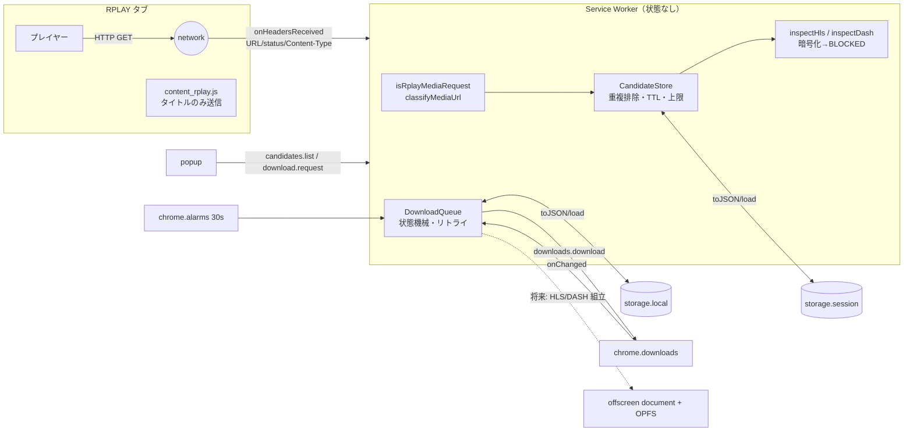
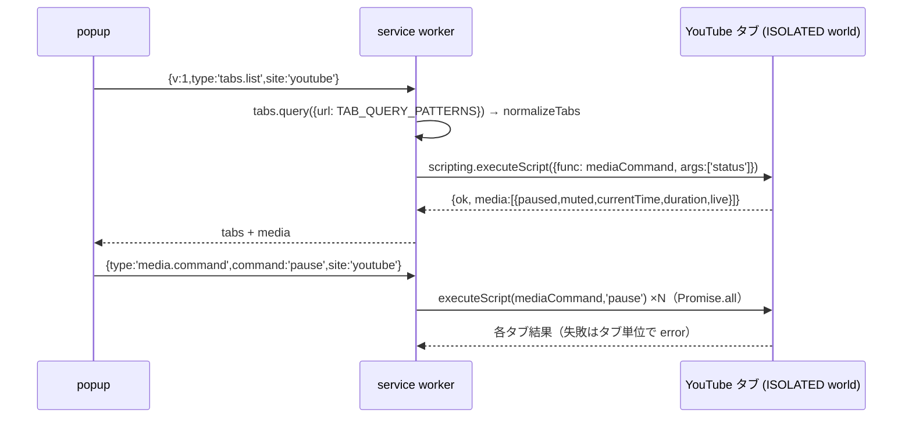
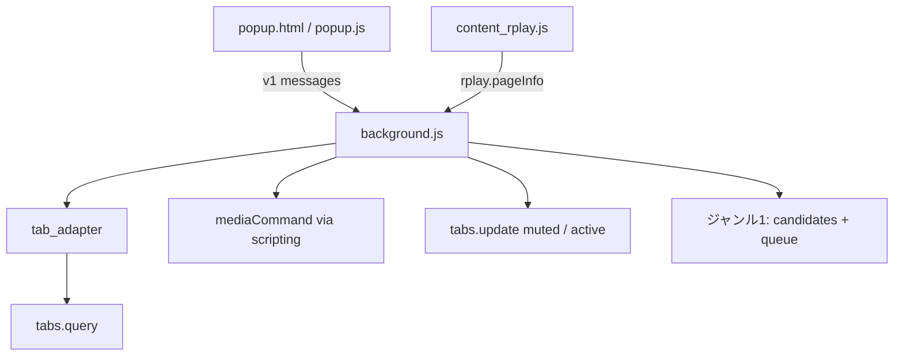

# RPLAY Stable Player 関連 3ジャンル詳細設計案（proposal / 2026-10-28）

状態: **PROPOSAL（未承認・未リリース）** / ゲート: **P0 / PUBLICATION_HOLD / NO_NEW_INTERNAL_PUSH**
作成: Grok Bot（AI 作成の提案。承認・デプロイ・リリースは別の明示ステップ）

> 実ブラウザでの読み込み・動作確認、実 RPLAY / 実 YouTube での E2E は **NOT_RUN**。
> 本書の数値・挙動はユニットテスト（合成データ）と静的確認のみに基づく。

---

## 0. 前提・入力・境界

### 0.1 入力（provenance）

| 種別 | 内容 | 識別子 |
|---|---|---|
| 正本候補（推奨・決定は NEEDS_HUMAN） | `RPLAY_Stable_Player_v2.50.0_UNIFIED_CANDIDATE.zip`（Drive バックアップフォルダ） | Drive file id `1lI2xr9-74Wjv1S1ciuqX4O-OkFw_LiSZ` / SHA-256 `e79eea624539fce0715b2f422163f1e3102eca589bc0f1521893bcfd2ed28347`（Drive の `SHA256SUMS.txt` と一致） |
| 比較対象 | v2.49.0 / v2.48.0 / gjgy…v2.48.0 / v2.48.0_MP4_HANDOFF_SAFETY / Quality_Continuity_Audit_Kit v0.1.0 | 同フォルダ。全件 SHA-256 一致を確認 |
| 公開実装（設計の参考のみ） | `0xddy/rplay-downloader` manifest `version: 2.0.0`（MV3） | https://github.com/0xddy/rplay-downloader commit `4c07560e742aa6e637584665987325e336a36f28`（2026-09-15）。タグ・Release なし。**LICENSE ファイルなし／GitHub API license=null** |
| ハブ | `r20942097-hue/faaff` main | base `479a15e4cfe43ad487081b0bb0d87a812bb0a24a` |

ZIP はリポジトリに入れていない（`.gitignore` と CI の ZIP 混入チェックに従う）。

### 0.2 公開実装の扱い（ライセンス）

- `0xddy/rplay-downloader` には LICENSE が無く、既定で **全著作権保留** と解釈する。**コードは一切コピーしていない**。読んだのは構成（webRequest で URL パターンを見る → manifest を取得・解析 → offscreen で処理 → downloads で保存、TaskStore の永続化、タブ遷移時のクリア）の考え方のみ。プロトタイプは独立実装。
- 同リポジトリは **Widevine CENC/CBCS をソフトウェア CDM で復号する機能**（`src/cdm-*.js`、`private/device.wvd`、`widevine-dash.ezdrm.com` への host 権限）を含む。これは DRM 回避にあたるため **学習対象から除外し、該当ファイルは開いていない**。本設計は DRM/暗号化メディアを検出したら **BLOCKED で停止** する。

### 0.3 安全・法務上の前提（NEEDS_HUMAN）

1. ダウンロード／保存は、**ユーザー自身がブラウザで正当に再生でき、かつ暗号化されていない**メディアに限る。
2. `#EXT-X-KEY`（METHOD≠NONE）・`#EXT-X-SESSION-KEY`・DASH `ContentProtection` を検出した時点で **取得しない（BLOCKED_ENCRYPTED / BLOCKED_DRM）**。復号コードは持たない。
3. 認証やペイウォールの回避、他人のトークン利用はしない。プロトタイプは manifest 検査で **Cookie/Authorization を送らない**（`credentials: 'omit'`）。401/403 は `auth-required` として表示するだけ。
4. **RPLAY の利用規約・配信者の権利の確認が必要（NEEDS_HUMAN）**。保存機能は既定 OFF で、ポップアップの確認チェックを入れたときだけ有効になる。チェックは法的確認の代わりにはならない。
5. YouTube は利用規約で動画のダウンロードを原則禁止しているため、**YouTube にはダウンロード機能を持たせない**。タブ制御（再生/停止/ミュート/状態）のみ。

---

## 1. ジャンル1: RPLAY 検出・ダウンロード

### 1.1 目的
- RPLAY タブで実際に発生した HLS(.m3u8) / DASH(.mpd) / MP4 リクエストを **観測だけ** で候補化する。
- 重複なく、上限・期限つきで保持し、service worker（SW）が止まっても状態を失わない。
- 保存は **ユーザーが明示操作したときだけ**、非暗号化メディアに限って `chrome.downloads` で行う。

### 1.2 権限

| 権限 | 理由 | 既存 v2.50.0 との差 |
|---|---|---|
| `webRequest` | `onHeadersReceived` で URL・Content-Type・status を観測（ブロックしない） | 同じ。ただし既存は `onBeforeSendHeaders` + `extraHeaders` で **全 https のリクエストヘッダ**を見ている → 提案では不要 |
| `storage` | `storage.session`（候補）・`storage.local`（ジョブ・設定） | 同じ |
| `alarms` | SW 再起動後のジョブ再駆動（30秒周期） | **既存 Chrome 版 manifest は `alarms` 未宣言なのに `chrome.alarms` を使う（guard で無効化されている）**。Firefox 版は宣言済み |
| `downloads` | 保存 | 同じ |
| host: `https://rplay.live/*`, `https://*.rplay.live/*`, `https://*.rplay-cdn.com/*` | 観測・manifest 取得の対象を RPLAY に限定 | 既存は `https://*/*`（全サイト）。CDN ドメイン `rplay-cdn.com` は公開実装から得た情報で **実在・網羅性は NEEDS_HUMAN（実機確認）** |
| （将来）`offscreen` | セグメント組立・OPFS・長時間処理 | 既存は使用中。プロトタイプでは未使用（最小権限） |

`cookies` / `webRequestBlocking` / `declarativeNetRequest` / `debugger` / `<all_urls>` は使わない（静的テストで禁止）。

### 1.3 アーキテクチャ



処理の流れ:
1. `onHeadersReceived`（filter: RPLAY ホストのみ）→ `isRplayMediaRequest`（tabId≥0, GET, type ∈ xmlhttprequest/media/other, ホストはドット境界で一致）→ `classifyMediaUrl`（拡張子 or Content-Type）。206 は MP4 のみ許可（セグメントの Range 応答を候補にしない）。
2. `CandidateStore.upsert`（キー `tabId|url`）。新規時だけ manifest を **1回** 取得して検査（同時実行は `inFlight` で抑止）。
3. `inspectHls`: master（variants を帯域降順・相対 URI 解決・AUDIO グループ）/ media（セグメント数・合計時間・ENDLIST）。`EXT-X-KEY`/`SESSION-KEY` が METHOD≠NONE なら `BLOCKED_ENCRYPTED`。`inspectDash`: `ContentProtection` があれば `BLOCKED_DRM`、`type="dynamic"` を記録。
4. 表示用には `redactUrl`（クエリ・フラグメント除去）だけを出す。署名トークン付き URL は popup・ログ・ジョブに出さない（テストで確認）。
5. 保存: popup の明示ボタン → `download.request` → 設定（`termsAcknowledged && downloadsEnabled`）と候補状態を確認 → `DownloadQueue.enqueue`（同一候補の重複不可）→ `pump()` で `chrome.downloads.download`。**HLS/DASH はプロトタイプでは `blocked`（SEGMENTED_ACQUISITION_NOT_IN_PROTOTYPE）**。直接 MP4 のみ。

### 1.4 安定化・バックグラウンド継続（MV3 SW 停止対策）

| 課題 | 対策 |
|---|---|
| SW は約30秒の無操作で停止し、メモリ状態が消える | 状態は全て `storage` に置き、各イベントの先頭で `load()`（1回だけ実行される Promise）。変更のたびに保存 |
| 停止中に進捗を見失う | `chrome.downloads` 自体はブラウザ側で継続。再起動時 `recoverAfterRestart()` が `downloads.search` で照合し、`in_progress` は維持、`complete` は完了、行方不明は `waiting_retry` に戻す |
| 定期処理が止まる | `chrome.alarms`（`periodInMinutes: 0.5`。Chrome 120+ の最小値。116〜119 では1分に切り上げられる）で `pump()` を再駆動。`onStartup`/`onInstalled` で alarm を再作成 |
| 重複 | 候補: `tabId|url` キー + TTL 15分 + タブごと20件 / 全体100件。ジョブ: 同一 candidate の非終端ジョブは1件 |
| 一時的失敗 | `retry.js`: 408/425/429/5xx・NETWORK 系のみ再試行。指数バックオフ（base 1s, cap 60s, full jitter）、最大4回 |
| 永続失敗 | 401/403/404 等は即 `failed`。候補失効は `CANDIDATE_EXPIRED` |
| タブ遷移 | `tabs.onUpdated(url)` / `onRemoved` で該当タブの候補を消す（実行中ジョブは継続） |
| 長時間の組立（将来） | offscreen document（`reasons: ['WORKERS'|'BLOBS']`）で行い、`runtime.getContexts` で重複生成を防ぐ。OPFS にセグメントを書き、ジョブ台帳に「取得済み seq」だけを持って再開。既存 v2.50.0 の `segment_store`（digest 検証・予算 LRU）と `acquire_host` の台帳設計を流用候補とする |
| keep-alive の乱用 | 既存の「録画中 alarm 0.4分で起こし続ける」は Firefox Event Page 向け。Chrome では offscreen の存続と alarms で足り、常時起床は避ける |

### 1.5 データモデル

```ts
type MediaType = 'hls' | 'dash' | 'mp4';
type CandidateStatus = 'observed' | 'inspected' | 'auth-required' | 'http-error'
  | 'inspect-error' | 'blocked-encrypted' | 'blocked-drm';
interface Candidate {           // storage.session 'candidates.v1'
  id: string; tabId: number; url: string /* 内部のみ。公開 view では displayUrl */;
  mediaType: MediaType; firstSeen: number; lastSeen: number; hits: number; status: CandidateStatus;
  variants?: { bandwidth: number; resolution: string; codecs: string }[];
  segments?: number; durationSec?: number; endList?: boolean; dynamic?: boolean; lastStatus?: number;
}
type Phase = 'queued'|'running'|'waiting_retry'|'completed'|'failed'|'canceled'|'blocked';
interface Job {                 // storage.local 'jobs.v1'
  id: string; candidateId: string; mediaType: MediaType; filename: string /* RPLAY/<安全化タイトル>.mp4 */;
  phase: Phase; attempts: number; nextAt: number; browserDownloadId?: number|null;
  error: { status?: number; errorCode?: string } | null; createdAt: number; updatedAt: number;
}
interface Settings { detectionEnabled: boolean; downloadsEnabled: boolean; termsAcknowledged: boolean } // storage.local
```

状態遷移: `queued→running|canceled|blocked`, `running→completed|waiting_retry|failed|canceled`, `waiting_retry→running|canceled|failed`。終端からの遷移は例外。

### 1.6 エラー処理
- 入力境界で fail-closed: URL は http(s)・userinfo なし・16KiB 以下。manifest は 2MiB 以下・`#EXTM3U` 必須・variant URI 欠落はエラー。
- fetch は `credentials:'omit'`, `redirect:'error'`, `AbortSignal.timeout(8000)`。
- エラー文字列は 80 文字に切り詰め、URL を含めない。
- 保存拒否理由を popup に返す: `DOWNLOADS_DISABLED` / `CANDIDATE_EXPIRED` / `BLOCKED_PROTECTED_MEDIA`。

### 1.7 テスト計画
| 層 | 内容 | 状態 |
|---|---|---|
| 単体（node --test） | URL 分類・ホスト境界・manifest 解析・暗号化/DRM 検出・候補の重複/TTL/上限/直列化・ジョブ状態機械/リトライ/再起動復旧/同時実行数 | 実行済み（結果は README） |
| 静的 | manifest の権限 allowlist・禁止権限・使用 API と権限の対応・参照ファイル存在 | 実行済み |
| 実ブラウザ | unpacked 読み込み、SW 停止（chrome://serviceworker-internals で Stop）後の復旧、downloads 中断/再開 | **NOT_RUN** |
| 実 RPLAY | 実配信・VOD での検出、CDN ホスト網羅、401/403 の扱い | **NOT_RUN / NEEDS_HUMAN**（規約確認後） |

### 1.8 既存 ZIP（v2.50.0）との差分と移行方針
| 項目 | 既存 v2.50.0 | 提案 | 移行 |
|---|---|---|---|
| 観測範囲 | `https://*/*` の全リクエスト + リクエストヘッダ（Referer/UA/Cookie 有無） | RPLAY ホストのみ・レスポンスヘッダのみ | 汎用サイト対応（CrossSite）を残すかは NEEDS_HUMAN。残す場合も opt-in の optional_host_permissions に分離 |
| 暗号化 HLS | content.js に AES-128-CBC 復号（`HLS.decryptCbc`）があり実使用、offscreen 側は `HLS_ENCRYPTED_UNSUPPORTED` | 検出したら BLOCKED。復号コードなし | **既存の復号経路の扱いは NEEDS_HUMAN**（本提案では引き継がない） |
| 認証 | offscreen がユーザー自身の JWT（`token.update`）を保持、manifest 取得に `useCookies` オプション | 認証情報を一切扱わない | 既存録画機能を維持する場合、トークン保持の範囲・保存先を別途レビュー |
| alarms | Chrome manifest に `alarms` 無し | 宣言 | 既存へは manifest 1行追加で済む（別 PR 候補） |
| 候補ストア | `media_catalog.js`（メモリのみ・SW 停止で消える） | `storage.session` に直列化 | `media_catalog` の SIGNED_RE / resolveMediaURI は有用。純粋関数として共存可能 |
| 保存 | 録画（offscreen + OPFS + rec_worker）→ salvage → downloads | 直接 MP4 のみ（プロトタイプ） | HLS/DASH 組立は既存 `segment_acquire`/`segment_store` を offscreen で再利用する案。暗号化/DRM ゲートを必ず前段に置く |

### 1.9 リスク
- RPLAY の URL 形式・CDN ドメインの変更（公開実装も API 版で変化したと記載）。→ 分類を設定化、未知形式は観測のみ。
- 署名付き URL の期限切れ（TTL 15分で候補を捨てる）。
- 利用規約違反のリスク（NEEDS_HUMAN）。
- `onHeadersReceived` の負荷（フィルタを RPLAY ホストに限定して軽減）。

---

## 2. ジャンル2: YouTube タブ制御

### 2.1 目的
開いている YouTube タブを一覧し、再生/停止/ミュートを **個別または一括** で操作、状態（再生中・ミュート・現在時刻・LIVE）を取得する。ダウンロードは扱わない。

### 2.2 権限
- `scripting` + host `https://www.youtube.com/*`, `https://m.youtube.com/*`, `https://music.youtube.com/*`。
- `tabs` 権限は不要（host 権限があるタブだけ `url`/`title` が見える。`tabs.query({url:[...]})` で十分）。
- ブラウザ側のタブ消音は `tabs.update(tabId,{muted})`（追加権限なし）。

### 2.3 アーキテクチャ

- `mediaCommand` は自己完結関数（import/closure なし、fetch/cookie/localStorage を参照しない。テストで確認）。`video, audio` を最大16要素まで操作。
- 既定の ISOLATED world で DOM の `<video>` を直接操作する。YouTube のプレイヤー内部 API（MAIN world）には触れない。

### 2.4 データモデル
```ts
interface TabView { tabId: number; windowId: number; site: 'rplay'|'youtube'; title: string;
  audible: boolean; tabMuted: boolean; active: boolean; discarded: boolean;
  media: MediaState[] | null; error: string | null }
interface MediaState { tag: 'video'|'audio'; paused: boolean; muted: boolean; volume: number|null;
  currentTime: number|null; duration: number|null; live: boolean }
```

### 2.5 エラー処理
- `play()` は自動再生ポリシーで `NotAllowedError` になり得る（ユーザー操作のないバックグラウンドタブ）。→ タブ単位で error を返し、一括処理全体は止めない。代替として「表示」ボタンでタブを前面化。
- `discarded` タブには注入しない（`status` 対象外）。
- 注入失敗（ページ遷移中・権限なし）はタブ単位の error。
- 対象は `tabs.query` で得たタブに限定し、popup から任意 tabId を渡されても allowlist で弾く。

### 2.6 テスト計画
単体: `normalizeTabs`（フィルタ・並び順・muted）、`mediaCommand`（偽 DOM で play/pause/mute/toggle/status/未知コマンド）、自己完結性。実 YouTube での操作・自動再生ポリシー・広告再生中の挙動は **NOT_RUN**。

### 2.7 既存 ZIP との差分
既存 v2.50.0 に YouTube タブ制御は無い（`content.js` に youtube 文字列 3 件のみ・機能なし）。新規機能として追加。

### 2.8 リスク
YouTube の DOM 変更（`<video>` 直接操作なので影響は小さい）、Shorts/埋め込み iframe（`allFrames:false` のため埋め込みは対象外。必要なら後で検討）、多数タブ同時注入の負荷（上限 100 tabIds）。

---

## 3. ジャンル3: RPLAY + YouTube 横断の統合マルチタブ管理

### 3.1 目的
RPLAY と YouTube のタブを1つの一覧で扱い、サイト絞り込み・一括操作・タブ消音・前面化を行う。RPLAY タブには検出候補と保存ジョブも並べる。

### 3.2 共通タブアダプタ
- `classifyTabUrl(url) → 'rplay'|'youtube'|null`（https のみ・ドット境界のホスト一致）。
- `normalizeTab(tab)` で共通形 `TabView` に変換。サイト固有処理はアダプタ表（将来 `adapters = {rplay:{...}, youtube:{...}}`）で差し替え: 例えば RPLAY では既存 `content.js` の再接続プレイヤーへメッセージで委譲、YouTube では `mediaCommand` を注入。
- 新しいサイトの追加は URL パターン + host 権限 + アダプタ1件で済む。

### 3.3 UI: ポップアップ（第一案）/ サイドパネル（第二案）
| | popup（プロトタイプで採用） | side panel |
|---|---|---|
| 権限 | 不要 | `sidePanel` |
| 常時表示 | 閉じると消える | 開いたまま操作できる |
| 最小 Chrome | 116 で可 | 114+ |
| 推奨 | 一括操作中心なら十分 | 長時間の監視・保存ジョブ監視が増えたら移行 |

UI の描画は `textContent` のみ（`innerHTML` 不使用）で、タイトル等によるスクリプト注入を防ぐ。

### 3.4 メッセージ設計（`lib/messages.js`、`v:1`）
| type | 送信元 | 引数 | 応答 |
|---|---|---|---|
| `tabs.list` | 拡張ページ | `site?` | `{ok, tabs: TabView[]}` |
| `media.command` | 拡張ページ | `command`, `tabIds?`, `site?` | `{ok, results:[{tabId,media,error}]}` |
| `tab.mute` | 拡張ページ | `tabIds`, `muted` | `{ok}` |
| `candidates.list` | 拡張ページ | — | `{ok, candidates, settings}` |
| `download.request` | 拡張ページ | `candidateId` | `{ok, job}` / `{ok:false,error}` |
| `jobs.list` / `settings.get` / `settings.set` | 拡張ページ | `settings`（既知キーのみ） | |
| `rplay.pageInfo` | RPLAY の content script | `title`（≤300） | `{ok}` |

送信者判定 `senderInfo`: `sender.id === runtime.id` かつ `sender.tab` 無し → 拡張ページ。`sender.tab` があり URL が rplay.live → content script。それ以外は `FORBIDDEN_SENDER`。バージョン不一致は `BAD_VERSION`。

### 3.5 アーキテクチャ


### 3.6 エラー処理・テスト
- 1タブの失敗が全体を止めない（`Promise.all` で各結果に error を持つ）。
- 単体: メッセージ検証（送信者・バージョン・引数型・未知 type）、`senderInfo`、`safeFilename`（パス区切り・予約文字除去、`RPLAY/` 配下固定）。
- 実ブラウザでの複数ウィンドウ・多数タブ・SW 停止中の popup 操作: **NOT_RUN**。

### 3.7 既存 ZIP との差分と移行
- 既存の `dashboard.html`（popup 兼 options）は録画・変換・検査の総合画面。提案の統合タブ一覧はその「タブ」セクションとして組み込むか、別 popup にして dashboard を options に残す二案。→ **NEEDS_HUMAN（UI 方針）**。
- 既存のメッセージは `rec.*`, `token.update`, `media.inspect.open` 等の文字列で版番号なし。提案の `v:1` 形式は既存と名前が衝突しない（`tabs.*`/`media.command`/`candidates.*`/`jobs.*`）ので並存可能。

### 3.8 リスク
host 権限追加（YouTube）によるインストール時警告の増加、既存 dashboard との二重 UI、メッセージ互換。

---

## 4. 段階的な導入（提案）

1. **P1（本ブランチ）**: 設計書 + 独立プロトタイプ + 単体テスト。既存 ZIP・既存ファイルは変更しない。
2. **P2**: 既存 v2.50.0 の Chrome manifest に `alarms` を追加する最小修正の要否判断（NEEDS_HUMAN）。
3. **P3**: 実ブラウザで unpacked 読み込み → SW 停止/復旧、YouTube 一括操作を手動確認（人が実施）。
4. **P4**: 利用規約確認後に限り、HLS 非暗号化 VOD の組立を offscreen + 既存 segment_store で実装（暗号化/DRM ゲート必須）。
5. 各段階は `proposal/*` ブランチ → PR。merge・リリースは所有者承認。

## 5. NEEDS_HUMAN 一覧（設計上）
- 正本 ZIP の決定（推奨 v2.50.0）。
- RPLAY 利用規約・配信者権利の確認と、保存機能を有効にしてよいかの判断。
- 既存 ZIP にある AES-128 復号経路・JWT 保持の扱い（引き継がない提案）。
- 汎用サイト（`https://*/*`）観測を残すか。
- `rplay-cdn.com` 等の CDN ホストの実在・網羅性。
- UI 方針（popup / side panel / dashboard 統合）。
- 公開実装（ライセンス無し）を参考にした設計の扱い（コードは非流用）。
