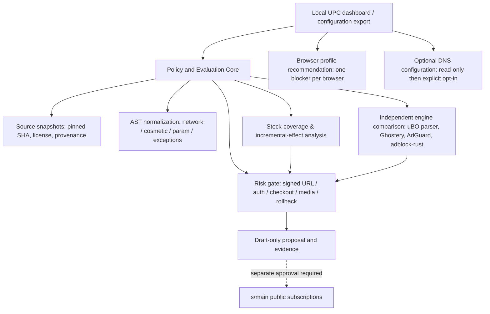

# Unified Privacy Control (UPC) v1.0 — architecture proposal

> Date: 2026-10-31 (JST) · Status: **DESIGN / NOT_IMPLEMENTED / NO_GO** · No live subscription changes.

## Decision (ADR-001)

**Build a local-first filter evaluation and management control plane, not another blocking extension.** Keep the actual content blocker selected per browser profile (Firefox/full uBO, Chromium/uBO Lite or equivalent MV3, Brave/Shields). Do not run multiple competing content blockers in one browser profile. DNS (AdGuard Home/Blocky) is a separate explicitly opt-in supplement, not a replacement for page-level blocking.

The engineering value is verified *incremental* protection over enabled stock lists, compatibility analysis, independent engine comparisons, transparent evidence, and safe rollback. Existing blockers already implement network and cosmetic filtering. A new Chromium extension would still be subject to MV3/DNR limits; a standalone HTTPS interception proxy would introduce TLS CA and OS/network risk.

### Existing source boundaries

- **`r20942097-hue/s`** is the live filter-list release authority. Keep `s/main`, filenames and all existing raw subscription URLs unchanged. Generated lists derive from `filter-profiles.json`, never directly edit generated TXT.
- **`r20942097-hue/faaff`** is the research / implementation / integration hub; work only on proposal branches until separately approved. Existing `integrations/browser-filters/source/s/` is a *pinned non-publishing snapshot*; never silently replace it with an unreviewed PR head.
- **`s` Draft PR #14** holds the candidate filter evidence: previously verified stable 9 tracking rules, optional v2 38, extra 0, 7 held stock duplicates. Its isolated real-HTTP experiments found that both global and narrowly path-scoped `removeparam=utm_source` can invalidate a synthetic HMAC-signed URL. Do not promote either experimental rule. Live-site/Firefox full-uBO E2E still NOT_RUN.

## Architecture

The management UI **does not imply remote control of third-party extensions**. Only supported public APIs, documented settings/import and exports may be used; otherwise show a human-readable plan and independent lab results. Do not display a green “protected” state if the browser's actual current settings are unverified.

## Components

| Module | Responsibility | Phase |
|---|---|---|
| Source Registry | immutable upstream refs, hashes, SPDX/provenance, update drift | 1 |
| Rule Normalizer | parse ABP/uBO/AdGuard syntax to typed AST while retaining resource/party/domain/exception semantics | 1 |
| Coverage Engine | evaluate effective overlap with **selected enabled** stock lists, not literal string matching alone | 1 |
| Engine Matrix | isolated uBO/Ghostery comparison; optionally AdGuard and Brave adblock-rust | 1–2 |
| Safety Gate | actual local HTTP, signed URL, OAuth, checkout, form/media, rollback regression | 2 |
| Profile Planner | browser-specific recommendation, DNS route checks, reversibility | 3–4 |
| Local Dashboard | coverage, provenance, unsupported syntax, risk, evidence, export and restoration | 3 |
| Release Control | draft proposal → verified candidate → owner-reviewed publication, default NO_GO | all |

**Initial implementation location:** `tools/privacy-control/` (separate from publishing `browser_filter_lists/`). Start Python 3.13+ and existing offline test infrastructure; use Node/TypeScript adapters only for proven AST and engine needs. Export report JSON/Markdown before implementing a heavy GUI.

### Proposed records

- `SourceSnapshot`: upstream repo, commit, file/blob SHA, license, retrieval date, data integrity.
- `RuleCandidate`: ID, raw syntax, normalized typed action, resource/party/source-domain scope, exceptions, source refs, review status.
- `CoverageFinding`: active engine and stock configuration, request case, stock matches, proposed delta, supported/unsupported reasons.
- `CompatibilityFinding`: engine/version/browser, parsed/ignored/truncated, DNR conversion errors and quotas.
- `RiskFinding`: signed URL, OAuth, forms, checkout, media, cookies, exception cases and evidence strength.
- `ReleaseDecision`: code SHA, source snapshot, tests and actual runs, human approval, rollback, release status.

Track `PASS/FAIL/BLOCKED/NOT_RUN/NEEDS_HUMAN/PARTIAL` explicitly. Isolated synthetic success must not be promoted into real-site safety.

## Security, privacy and licenses

Default = local data only, read-only, no DNS/proxy changes, no root CA, no Windows driver, no browser history or raw URL query/cookies/tokens stored. Use reserved synthetic domains and loopback HTTP for automated tests. The DNS module must detect possible browser DoH bypass and never imply universal coverage. Existing CC0 root and GPL-3.0-only v2 outputs keep separate provenance; imported engine code must respect upstream license (Ghostery and adblock-rust MPL-2.0).

Do not publish candidate rule updates from upstream search results alone. Preserve current `s` URLs, protected `main`, and source snapshots. No automatic merge, Release, force-push, ZIP upload or production deployment.

## Delivery plan and acceptance

| Phase | Output | Minimum acceptance |
|---|---|---|
| 0: baseline | known-good source/CI/stock config report | `s/main` and published outputs unchanged, pinned evidence identifiable |
| 1: offline MVP | schema + fixed source registry + semantic overlap + two-engine comparison + JSON report | all existing 38 optional tracking entries classified; 7 held duplicates unchanged; repeated runs deterministic; missing evidence fails closed |
| 2: browser verification | isolated Firefox uBO and Chromium uBOL actual loopback HTTP | exact before/on/off restoration, signed URL and auth regressions, unsupported platform modes disclosed |
| 3: local UI | readable coverage/risk/profiles/history/exports | no unverified protection claims; no hidden writes; warnings and rollback are visible |
| 4: optional DNS | opt-in DNS route planning and config export | no automatic system setting changes; DNS route/DoH status known or explicitly unknown |
| 5: release review | measured incremental outcomes + real-site safety review | owner approval required, existing subscription URLs retained; actual E2E is separate |

Metrics to measure (do not preclaim numbers): incremental blocks beyond stock; false blocks by auth/checkout/video/form/signed URL; engine parse/ignored/truncated counts; processing time/RAM; rollback success; source/evidence coverage.

## Next implementation slice

1. Define versioned `RuleCandidate`, `CoverageFinding` and `ReleaseDecision` JSON Schemas.
2. Build immutable stock-list source registry and read-only overlap evaluator using existing `s` rules and pinned uBOL data.
3. Add unit fixture for duplicates, subset overlap, exception priority, unsupported syntax, synthetic signed URL hazard, and no-publication gate.
4. Produce one JSON + Markdown report and compare against independent Ghostery/uBO engines.
5. Only then implement a lightweight local dashboard; defer DNS/OS writes.

## Confirmed upstream references

- [uBOL FAQ / custom subscriptions and single-blocker guidance](https://github.com/uBlockOrigin/uBOL-home/wiki/Frequently-asked-questions-%28FAQ%29)
- [Chromium declarativeNetRequest limits](https://developer.chrome.com/docs/extensions/reference/api/declarativeNetRequest/)
- [Firefox webRequestBlocking](https://developer.mozilla.org/en-US/docs/Mozilla/Add-ons/WebExtensions/API/webRequest/onAuthRequired)
- [AdGuard AST, DNR, webextension libraries](https://github.com/AdguardTeam/tsurlfilter)
- [Ghostery JS/TS engine](https://github.com/ghostery/adblocker)
- [Brave adblock-rust](https://github.com/brave/adblock-rust)
- [AdGuard Home DNS limitations](https://github.com/AdguardTeam/AdGuardHome)

**Release gate: NO_GO. This document specifies a proposed architecture only; none of these new components is claimed to be implemented.**

## Implementation progress (2026-10-31)

**Phase 1 implemented in Draft PR #43**: offline read-only normalized exact-overlap analyzer, manifest-pinned Git blob identity checks, deterministic JSON output, 3.11/3.14 Python regression gates. Confirmed on the pinned 2026-10-28 `s/main` snapshot: 9 stable tracking entries, 38 optional v2 entries, nine exact normalized overlaps. This is *not* an EasyPrivacy/uBO Lite stock coverage measurement. Phase 1.5 adds pinned uBO + Ghostery synthetic-request comparison and explicit opt-out precedence controls. Both engines operate in independent, isolated CI fixtures; publication remains NO_GO.

No browser add-on, DNS server, Windows service, HTTPS interception engine, local dashboard or live-site safety test has been implemented. Do not infer actual end-user privacy benefit from the offline or synthetic tests.

## Phase 2c extension — official template closure

A verified source-manifest traversal now resolves the complete pinned source
closure from the upstream `easyprivacy.template`, with immutable file hashes
and include-order checks. The fixed-input experiment runs alongside, not in
place of, the five-part subset. Its purpose is to separate candidate matches
already covered by the officially templated stock rules from synthetic
incremental matches, without assuming browser configuration or equating the
template expansion to the published built subscription.

The CI gate remains **NO_GO** until exact browser stock subscriptions,
real Firefox/uBO or Chromium/uBOL and essential real-site flows are exercised.

## Isolated installed-browser gate

A separately pinned official signed Firefox uBO XPI and an ephemeral
Firefox+Selenium profile exercise **actual local HTTP interception**:
baseline → installed extension → uninstall and restoration. The runner's
synthetic hostname resolves only to loopback. This is an incremental
browser gate beyond the two in-process parsing engines and does not
replace real-site testing or actual user stock-list review. The XPI is
downloaded only to ephemeral storage, not committed to the repository.

## Browser observation caveat (2026-10-31)

Full Firefox signed uBO CI testing is **BLOCKED** by failed benign cross-host
negative controls. Target blocking and same-origin availability are observed,
but target-specificity and post-removal rollback are NOT_VERIFIED. Five
records are preserved in `../verification/firefox-isolation-diagnostic.json`.
The browser job requires manual research invocation and is not a release gate.
The stable UPC offline/engine evaluation remains available; release NO_GO.

## Phase 2e result — installed Firefox and rollback

An explicit no-forwarding localhost HTTP proxy finally distinguished the
tracker-host test request from benign first-party, same-site, and unrelated
third-party local fixtures. The official signed uBO was installed in an
ephemeral Firefox profile and then uninstalled. The strict
`firefox-http-proxy-synthetic` job passed in CI run 41097729808;
`verify_firefox_proxy.py` checks the full before/on/uninstall lifecycle.
Earlier five failed local-IP mapping tests remain separate and unresolved,
not silently rewritten as passes.

This establishes **isolated installed-extension HTTP behavior only**.
The candidate list was not installed, and user-specific enabled subscriptions,
live websites, signed URLs, authentication, media and Windows/Floorp still
need separate validation. Release gate is **NO_GO**.

## Phase 2h decision record

Observed in [real ephemeral Firefox CI 41102700720](https://github.com/r20942097-hue/faaff/actions/runs/41102700720):
one additionally blocked third-party image-host fixture vs the installed
signed uBO's stock configuration; 37 of 38 candidate host fixtures were
already blocked by stock. The exact additional hostname was not captured
on this first run. No claim of independent per-rule effectiveness.
Each stage now requires two matching independent image-batch samples.
The experiment records per-host deltas and retains a NO_GO release gate.
The complete official EasyPrivacy template-source comparison and real
installed uBO stock experiment have different scopes; no numerical
equivalence is inferred.
